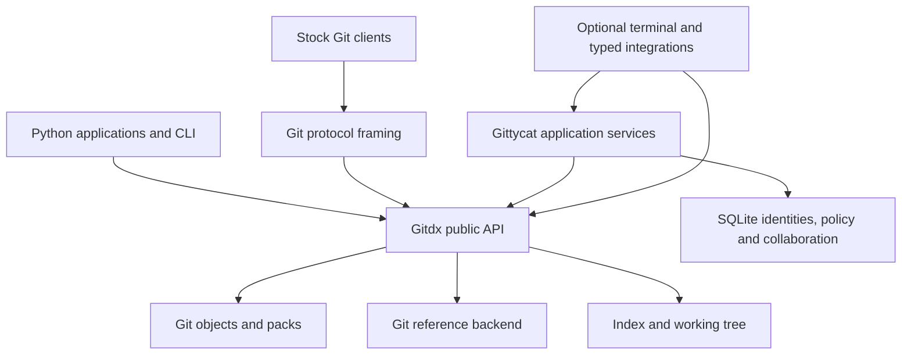

# Gitdx → Gittycat implementation plan

## DX-28 explicit reftable writer (27 November 2026)

An explicit trusted-local writer now provides expected-value batches through the
native stack lock and one atomic stack-list replacement. Complete-stack
compaction preserves case, symbols, ref update indexes and native reflog bytes.
Before/after journals qualify process-interruption recovery without overwriting
later native edits or stealing lockfiles. Default repository mutations remain
read-only; untrusted/hosted writes and retired-table deletion remain separate.
See [reftable storage](docs/reftable.md) for bounds and platform qualification.

## DX-29 isolated translation (27 November 2026)

The explicit `GraphTranslator` API translates complete unsigned graphs between
separate SHA-1/SHA-256 stores without publishing refs. Versioned SQLite mappings
are verified against object bytes on every run. Signatures, mergetags and
gitlinks refuse before writes; migration and cross-format transfer remain gated.
See [translation](docs/translation.md) for bounds, restart and cache semantics.

## Read-serving interface (26 November 2026)

CAT-07A supplies the engine interface required by Gittycat CAT-07. Implement
bounded stateless v0/v1/v2 discovery, ls-refs and upload-pack responses, common
have acknowledgments and complete advertised-tip packs. Reuse the existing
framing, typed object graph and pack writer; add cooperative writer checks.
Qualify stock Git clone/fetch, both formats, tags, empty repositories and a
separate installed empty-PATH worker. Gittycat owns catalog authorization,
credentials, Expose API routes, concurrent preparation limits and disconnect
cleanup. No framework dependency belongs in Gitdx. Publication and deployment
remain separate gates.

Planning baseline: 22 November 2026. Both projects use Python 3.14+ and the MIT
license. Version labels below describe qualification milestones; they do not
authorize releases or promise dates.

## Purpose and ownership

Gitdx is an independent Python implementation of Git-compatible repository
storage, local operations and transport. Its runtime uses only the standard
library and never invokes the Git executable. Its Python API works without a
terminal interface, hosting application or optional integration.

Gittycat is a single-node Git hosting and collaboration application powered by
Gitdx. It owns identities, permissions, repository metadata, branch policy,
collaboration and interfaces. It delegates Git objects, refs, history, packs and
protocol algorithms to Gitdx. Gittycat does not maintain a second branch-tip
authority in its database.

The [shared Project](https://github.com/orgs/wispsy/projects/30) and owning issues
are the execution queue. This document owns architecture, sequencing and
qualification contracts. PRs record implementation decisions and evidence.
The [Gittycat plan](https://github.com/wispsy/gittycat/blob/main/IMPLEMENTATION_PLAN.md)
details the hosting boundary.

## Inputs and decisions

The design reconciles **gitdx and gittycat gist00.md** and **gitdx and gittycat
gist01.md**. The second document's interoperability and hosting roadmap refines
the first. These are design proposals, not evidence that a feature already
exists. Undated upstream predictions and historical security statements are not
used as release requirements.

Selected foundations:

- Retain the fresh packages' Python 3.14 minimum and uv build backend.
- Public `wispsy/gitdx` and `wispsy/gittycat` repositories; MIT for each.
- Standard-library-only Gitdx, including its default transports. Third-party
  transports and user interfaces are optional adapters.
- Immutable bytes are authoritative for objects. SHA-1 is the default repository
  format; identities carry their algorithm from the first implementation.
  Native SHA-256 object/storage fixtures start immediately.
- Files refs first; unsupported extensions and formats are refused before
  mutation. Reftable reading and writing are separate milestones.
- Gittycat begins as a modular monolith with SQLite platform metadata, bare
  repositories under opaque storage IDs, and smart HTTP before SSH.
- unittest is the test framework. Installed Git is a development-only oracle.
  No runtime dependency is added to the Gitdx package.

## Architecture and contracts

### Objects and formats

`ObjectFormat` selects SHA-1 or SHA-256 and its full binary/hex OID width.
`ObjectId` always includes that format; cross-format comparisons and references
cannot silently mix. Loose-object identity hashes the exact type, decimal byte
length, NUL and payload. Blob payloads are arbitrary bytes. Tree entries retain
byte names, Git modes and format-correct child IDs, sorted by Git tree order.
Commit/tag codecs preserve unknown headers, continuation lines, encodings,
messages and signatures without normalization. Structural validation is distinct
from graph/type validation and cryptographic signature verification.

`ObjectStore` reads/writes typed raw objects. `LooseObjectStore` validates the
requested hash, header, size and complete zlib frame. Limits cover compressed
bytes, expanded bytes and headers. A complete temporary file is flushed before
publication; existing objects are never blindly replaced. Pack implementations
later add checksums, offsets, counts, delta depth, operation and aggregate budgets.

### Repository, configuration and references

`Repository.init`, `open` and explicit `discover` distinguish bare repositories
from worktrees. Initialization never replaces existing metadata. Repository
format, object format, ref storage and required extensions are checked before
operations. Local config parsing starts with a stated subset; unsupported quoting,
includes or extensions fail explicitly rather than being approximated.

`RefStore` hides files/reftable storage. Direct and symbolic refs, unborn HEAD
and detached HEAD are distinct values. Ref changes require an expected-old ID
or an explicit create-only expectation. Single-file updates use exclusive Git
lockfiles and atomic replacement. Symbolic traversal is bounded and cycle-aware.
Packed refs, reflogs, multi-ref coordination and reftable each have their own
qualification. Coordinated file updates do not imply atomic visibility to native
readers; protocol capabilities must reflect the actual backend guarantee.

### Local operations and history

The index owns stages, stat metadata, paths and a format-specific checksum.
Unknown mandatory extensions, split/sparse indexes and unsupported versions are
refused until implemented. Staging, status, commit and checkout build on that
contract. Checkout validates all paths and protects modified/untracked files.
External filters, hooks, merge drivers and signing helpers never execute merely
because repository configuration asks for them.

History traversal is iterative and budgeted. Diffs retain binary/text distinctions.
Merge operations preserve conflict stages and recovery state. Reset, restore,
rebase and other destructive operations need explicit mutation plans. Gitlinks,
linked worktrees, attributes and sparse checkout remain named compatibility work,
not implied support from successful basic repository opening.

### Transport and receive

Packet lines, sidebands and negotiation are binary Git protocols, distinct from
JSON APIs. Implement same-format SHA-1/SHA-1 and SHA-256/SHA-256 clone/fetch/push
before translated exchange. Protocol v2 `object-format` identifies a format; it
does not supply a conversion engine. Limit packets, object graphs, bytes, time
and cancellation, and isolate credentials across redirects/peers.

Receive follows: authorize caller → quarantine → validate pack and reachable
graph → apply ref policy → publish verified objects → compare-and-swap refs →
record outcomes. No accepted ref may point to unavailable/unverified objects.
Object publication followed by ref rejection may leave unreachable objects for
later maintenance. Atomic versus individual-ref success must be explicit.

### Translation and migration

Translation is an independent experimental subsystem. Rewrite actual object
references in dependency order; ordinary message text is untouched. Persist
versioned bidirectional mappings and provenance with sqlite3. Detect signed
commits/tags, mergetags and gitlinks before conversion. Require a selected policy;
never silently re-sign or imply an original signature verifies changed bytes.
Migrations produce an isolated destination, preserve the source, verify graph
equivalence and publish destination refs last. Local conversion is separate from
stock Git cross-format transport interoperability.

## Milestones and exit criteria

| Milestone | Scope | Required evidence |
| --- | --- | --- |
| First source batch | DX-01–04 and CAT-01 | Typed byte codecs, bounded loose objects, init/open/plumbing CLI, single-ref CAS, pure hosting permissions; native Git fixtures in both hashes |
| Gitdx 0.1 | Objects and repository plumbing | Stock Git recognizes written blobs/trees/commits/tags and refs; corrupt input and write failures preserve repository state |
| Gitdx 0.2 | Index, add/status/commit/log/branch/checkout | Both tools operate on the same supported local repository; dirty/untracked content stays protected |
| Gitdx 0.3 | Config/ignores, packed refs/objects and deltas | Inspect and modify the selected profile after native Git gc; capability registry names every supported/refused format |
| Gitdx 0.4 | Diff, revisions, merge and reset | Equivalent supported tree/history results; conflict stages and interrupted-operation recovery |
| Gitdx 0.5 | Packs and remote exchange | Bidirectional stock Git clone/fetch/push with same-format SHA-1 and SHA-256 repositories |
| Gitdx 0.6 | Interoperability and reftable reading | Installed compatibility matrix, truthful capability report, format negotiation and read-only reftable evidence |
| Gitdx 0.7 | Quarantine, policy seams and ref transactions | Malformed graphs, stale writers and interrupted receives never publish invalid refs |
| Gitdx 0.8 | Hardened storage, reftable writes, maintenance, stable backend | Concurrent mutation, crash recovery, backup/restore and installed source/wheel/sdist qualification |
| Gittycat prototype | Local stock-Git hosting | Two authorized clients clone/push/fetch; outsiders cannot discover or retrieve private repository data |
| Gittycat 0.8 alpha | Single-node forge with collaboration | Users/orgs/tokens, shared policy, smart HTTP, browser views, reviewed PR merge, audit/jobs and restore pass installed acceptance |
| Experimental conversion | Isolated translation, then migration, then selected-peer transfer | Bidirectional graph equivalence and source preservation; explicit signature/gitlink rules; stock-Git claims require real exchange evidence |
| 0.9+ | Advanced porcelain, SSH/LFS/CI and scaling | Independently scoped contracts and owning issues before implementation |

These gates are feature contracts, not a requirement to release every numbered
intermediate package. Translation need not block useful same-format hosting.
The proposed 0.6.x conversion breakdown in the input is represented by DX-29–31;
patch version assignment waits for actual API/release decisions.

## Integration ownership

| Component | Role | Dependency rule |
| --- | --- | --- |
| Gitdx | Git objects, refs, index, history, packs, protocols | No third-party runtime packages or Git executable |
| Gittycat | Identity, authorization, catalog, collaboration and hosting services | Mandatory qualified Gitdx backend; other integrations selected explicitly |
| Expose API | Management API and application HTTP adapter | Inspect current API before use; keep binary Git routes distinct |
| Requ / Apiconn | Optional outgoing HTTP/API clients | No mandatory external service; explicit credentials and destinations |
| Carets | Optional terminal application | Presentation and selection, outside storage/authorization |
| Hidden Moves | Optional selected typed capabilities | Ordinary callable APIs first; separate reads, mutations, network and rewrites |
| Moveset | Optional explicit multi-step workflows | Do not assume branching/iteration capabilities without inspecting current implementation |
| Astree | Optional read-only browsing/source-analysis adapters | Does not own Git storage or on-disk parsing |
| Gitwriter | Optional history-rewrite backend adapter | Native backend must not call installed Git; explicit rewrite plans |

Optional integrations remain independently installable. Inspect their current
owning source before designing an adapter; the input documents' package
assessments are historical. No ecosystem dependency is added speculatively.

## Verification and evidence

The [native compatibility matrix](docs/qualification.md) binds each selected
source/wheel/sdist result to its exact implementation, runtime, Git/uv versions,
source revision and artifact identity. It exercises both native hash formats,
local and smart-HTTP client/storage exchange, explicit-tree diffs, revision
resolution and all two-root merge bases. Separate no-Git workers and mandatory
refusal/corruption/resource fixtures keep evidence scopes explicit. Native CGI
test peers do not establish production server support or cross-format exchange.

Each implementation includes focused unittest cases for its changed behavior,
then the relevant local suite. CI runs Python 3.14 on Linux, macOS and Windows,
plus installed artifact checks. Use fresh CI for unchanged work; rerun affected
checks after conflict/code changes. Native Git oracle jobs must actually run,
with skips failing required interoperability qualification. Record Git/Python
versions and selected hashes in receipts.

The fixture matrix grows with the implementation:

- SHA-1 and SHA-256, empty/nonempty, bare/worktree, binary and raw path bytes.
- Unknown headers/signatures, multiline values, tree modes/order and object kinds.
- Loose/packed objects, native gc, packed refs, detached/unborn HEAD and reftable.
- Truncated/corrupt/checksum-invalid/oversized input, deep graphs and delta bombs.
- Traversal, symlink parents, metadata aliases, platform name/case collisions,
  existing locks, permission failures and competing expected-old updates.
- Interrupted object/ref/index/checkout/receive/maintenance publication with
  deterministic fault injection and recoverable outcomes.
- Installation from wheel and sdist outside checkouts; stdlib-only runtime with
  no Git on PATH. Git remains available only to the separate oracle profile.
- Real loopback smart HTTP, two authorized users, a denied outsider, restart,
  backup/restore and browser collaboration before forge qualification.

A machine-readable capability registry will be backed by passing tests and
identify exact supported operations/formats/backends. Unimplemented features
stay false or explicitly experimental. Gittycat checks this profile before
opening a backend or advertising a protocol capability.

## Storage and trust limits

The first implementation targets owner-controlled local repositories. Checking
static symlinks is useful but is not proof against an attacker concurrently
replacing directories. Hosting qualification must resolve that boundary, crash
durability, resource accounting and platform behavior before accepting hostile
input. File flushing and atomic visibility are separate from power-loss durability.

Ordinary hashlib SHA-1 establishes compatible IDs; it is not equivalent to
collision-detecting SHA-1 ingestion. DX-26 requires a validated collision policy
or disabled untrusted SHA-1 hosting. Native SHA-256 support does not eliminate
path, concurrency, compression or authorization risks.

Never execute code from hosted repositories by default. No automatic hooks,
filters, merge drivers, credential helpers or signing commands. Runtime limits
must be applied before allocation/decompression and during graph/delta work.
Repository-controlled URLs/configuration cannot silently select credentials or
external services.

## Execution and release boundaries

The first batch has five focused implementation PRs: DX-01, DX-02, DX-03,
DX-04 and CAT-01. Same-repository dependencies stack on the preceding local
branch; independent Gittycat work proceeds while engine CI runs. Collect all
results, correct failures and integrate passing work. For this batch, squash
children into their parent from the deepest child upward, then squash the root
into main. Reconcile dependent bases and record each task's final-main inclusion
before deleting completed branches. Cross-repository prerequisites cannot be
resolved by a stack; qualify selected commits/artifacts explicitly.

Project fields carry Task, Order, Phase, Readiness, Dependencies and Status.
Native blocked-by links express prerequisites. Ready means prerequisites are
complete; Decision identifies an actual policy/owner gate. Advance readiness
from verified merged results, not from a local placeholder. Record completed
scope, verification, limitations and the next useful task on issue closure/PRs.

Source implementation, commits, pushes, focused PRs and passing squash merges
are in scope. Package publication, release tags and public deployment are
separate owner actions. Before proposing one, prepare the exact artifacts,
configuration, evidence and rollback plan. Advanced migration/rewrite operations
also require their explicit target and policy; a roadmap item is not permission
to rewrite a user's repository.

## Upstream specifications

Implementation is checked against primary Git documentation, including
[loose objects](https://git-scm.com/docs/gitformat-loose),
[repository layout and format versions](https://git-scm.com/docs/gitrepository-layout),
[index format](https://git-scm.com/docs/gitformat-index),
[pack format](https://git-scm.com/docs/gitformat-pack),
[ref names](https://git-scm.com/docs/git-check-ref-format),
[protocol v2](https://git-scm.com/docs/gitprotocol-v2),
[smart HTTP](https://git-scm.com/docs/gitprotocol-http),
[reftable](https://git-scm.com/docs/reftable) and
[hash transition](https://git-scm.com/docs/hash-function-transition).
Design proposals do not replace tested upstream behavior.

## Task register

The linked issues below own detailed acceptance criteria and verification.
Later broad workstream/decision items must be split before implementation.

| Task | Owner and scope | Phase | Prerequisites |
| --- | --- | --- | --- |
| [DX-01](https://github.com/wispsy/gitdx/issues/1) | gitdx: Format-aware object model and byte-preserving codecs | 0.1 Objects | None |
| [DX-02](https://github.com/wispsy/gitdx/issues/2) | gitdx: Bounded atomic loose-object storage | 0.1 Objects | DX-01 |
| [DX-03](https://github.com/wispsy/gitdx/issues/3) | gitdx: Repository lifecycle, format detection and plumbing CLI | 0.1 Objects | DX-02 |
| [DX-04](https://github.com/wispsy/gitdx/issues/4) | gitdx: Loose refs, HEAD and compare-and-swap updates | 0.1 Objects | DX-03 |
| [CAT-01](https://github.com/wispsy/gittycat/issues/1) | gittycat: Hosting domain and explicit repository permissions | Foundation | None |
| [DX-05](https://github.com/wispsy/gitdx/issues/5) | gitdx: Git index v2 codec and locked staging transactions | 0.2 Local | DX-04 |
| [DX-06](https://github.com/wispsy/gitdx/issues/6) | gitdx: Add, status and baseline exclusion rules | 0.2 Local | DX-05 |
| [DX-07](https://github.com/wispsy/gitdx/issues/7) | gitdx: Commit creation and bounded history | 0.2 Local | DX-06 |
| [DX-08](https://github.com/wispsy/gitdx/issues/8) | gitdx: Safe branch switching and working-tree checkout | 0.2 Local | DX-07 |
| [DX-09](https://github.com/wispsy/gitdx/issues/9) | gitdx: Repository configuration, excludes and attribute policy | 0.3 Existing | DX-08 |
| [DX-10](https://github.com/wispsy/gitdx/issues/10) | gitdx: Packed refs and reflog coordination | 0.3 Existing | DX-04 |
| [DX-11](https://github.com/wispsy/gitdx/issues/11) | gitdx: Pack indexes and bounded base-object reading | 0.3 Existing | DX-02 |
| [DX-12](https://github.com/wispsy/gitdx/issues/12) | gitdx: OFS and REF delta resolution | 0.3 Existing | DX-11 |
| [DX-13](https://github.com/wispsy/gitdx/issues/13) | gitdx: Existing-repository qualification and capability registry | 0.3 Existing | DX-09, DX-10, DX-12 |
| [DX-14](https://github.com/wispsy/gitdx/issues/14) | gitdx: Text and binary diff contracts | 0.4 History | DX-13 |
| [DX-15](https://github.com/wispsy/gitdx/issues/15) | gitdx: Revision resolution, ancestry and merge bases | 0.4 History | DX-13 |
| [DX-16](https://github.com/wispsy/gitdx/issues/16) | gitdx: Three-way merges and conflict state | 0.4 History | DX-14, DX-15 |
| [DX-17](https://github.com/wispsy/gitdx/issues/17) | gitdx: Reset and restore with explicit mutation plans | 0.4 History | DX-16 |
| [DX-18](https://github.com/wispsy/gitdx/issues/18) | gitdx: Pack writing and object-graph enumeration | 0.5 Remotes | DX-12 |
| [DX-19](https://github.com/wispsy/gitdx/issues/19) | gitdx: Packet lines and protocol negotiation | 0.5 Remotes | DX-18 |
| [DX-20](https://github.com/wispsy/gitdx/issues/20) | gitdx: Same-format fetch and clone | 0.5 Remotes | DX-19, DX-08 |
| [DX-21](https://github.com/wispsy/gitdx/issues/21) | gitdx: Same-format push and report-status | 0.5 Remotes | DX-20, DX-10 |
| [DX-22](https://github.com/wispsy/gitdx/issues/22) | gitdx: Native SHA-1 and SHA-256 compatibility qualification | 0.6 Compatibility | DX-21, DX-13 |
| [DX-23](https://github.com/wispsy/gitdx/issues/23) | gitdx: Reftable reading and backend selection | 0.6 Compatibility | DX-22 |
| [DX-24](https://github.com/wispsy/gitdx/issues/24) | gitdx: Quarantined receive transactions and connectivity checks | 0.7 Receive | DX-22 |
| [DX-25](https://github.com/wispsy/gitdx/issues/25) | gitdx: Reference transaction guarantees and concurrency | 0.7 Receive | DX-24, DX-10 |
| [DX-26](https://github.com/wispsy/gitdx/issues/26) | gitdx: Hosting storage hardening and SHA-1 ingestion policy | 0.8 Storage | DX-25 / policy gate |
| [DX-27](https://github.com/wispsy/gitdx/issues/27) | gitdx: Reachability maintenance, GC and backup primitives | 0.8 Storage | DX-26 |
| [DX-28](https://github.com/wispsy/gitdx/issues/28) | gitdx: Reftable writing and recovery | 0.8 Storage | DX-23, DX-25 |
| [DX-29](https://github.com/wispsy/gitdx/issues/29) | gitdx: Isolated graph translator and persistent object mappings | Experimental conversion | DX-22 |
| [DX-30](https://github.com/wispsy/gitdx/issues/30) | gitdx: Verified non-destructive repository migration | Experimental conversion | DX-29, DX-27 / policy gate |
| [DX-31](https://github.com/wispsy/gitdx/issues/31) | gitdx: Experimental cross-format transfer | Experimental conversion | DX-30, DX-21 / policy gate |
| [DX-32](https://github.com/wispsy/gitdx/issues/32) | gitdx: Advanced porcelain and repository-format workstreams | 0.9+ Advanced | DX-17, DX-27 / policy gate |
| [DX-33](https://github.com/wispsy/gitdx/issues/33) | gitdx: Hosting-ready API and installed engine qualification | 0.8 Storage | DX-27, DX-28, DX-22 |
| [CAT-02](https://github.com/wispsy/gittycat/issues/2) | gittycat: SQLite catalog, migrations and audit outbox | Foundation | CAT-01 |
| [CAT-03](https://github.com/wispsy/gittycat/issues/3) | gittycat: Bare repository provisioning through gitdx | Foundation | CAT-02, DX-04 |
| [CAT-04](https://github.com/wispsy/gittycat/issues/4) | gittycat: Accounts, organizations and token authentication | Identity | CAT-02 |
| [CAT-05](https://github.com/wispsy/gittycat/issues/5) | gittycat: Branch protection and ref-change policy | Policy | CAT-04, DX-15 |
| [CAT-06](https://github.com/wispsy/gittycat/issues/6) | gittycat: Management API with Expose API integration | Management API | CAT-03, CAT-04 |
| [CAT-07](https://github.com/wispsy/gittycat/issues/7) | gittycat: Smart-HTTP advertisement and upload-pack | Smart HTTP | CAT-06, DX-22 |
| [CAT-08](https://github.com/wispsy/gittycat/issues/8) | gittycat: Receive-pack with quarantine and policy enforcement | Smart HTTP | CAT-07, CAT-05, DX-26, DX-24 |
| [CAT-09](https://github.com/wispsy/gittycat/issues/9) | gittycat: Local two-user stock-Git hosting acceptance | Prototype acceptance | CAT-08 |
| [CAT-10](https://github.com/wispsy/gittycat/issues/10) | gittycat: Repository browser and safe commit/diff views | Browser | CAT-09, DX-14 |
| [CAT-11](https://github.com/wispsy/gittycat/issues/11) | gittycat: Pull requests, comments, reviews and checked merge | Collaboration | CAT-10, CAT-05, DX-16 |
| [CAT-12](https://github.com/wispsy/gittycat/issues/12) | gittycat: Durable jobs, audit queries and optional webhooks | Operations | CAT-08, CAT-02 |
| [CAT-13](https://github.com/wispsy/gittycat/issues/13) | gittycat: Backup, restore, quotas and single-node operations | Operations | CAT-11, CAT-12, DX-27 / policy gate |
| [CAT-14](https://github.com/wispsy/gittycat/issues/14) | gittycat: Selected typed operations and terminal/workflow adapters | Optional integrations | CAT-11, DX-33 / policy gate |
| [CAT-15](https://github.com/wispsy/gittycat/issues/15) | gittycat: Installed forge alpha and security qualification | 0.8 Alpha | CAT-13, DX-33 |
| [CAT-16](https://github.com/wispsy/gittycat/issues/16) | gittycat: Owner-selected publication and deployment | Release and deployment | CAT-15 / policy gate |
| [CAT-17](https://github.com/wispsy/gittycat/issues/17) | gittycat: Immutable cross-repository installation profile | Composition | CAT-03, DX-04 |
| [DX-FIX-01](https://github.com/wispsy/gitdx/issues/38) | gitdx: Stop discovery at incomplete repository metadata | 0.1 Objects | DX-03 |
| [DX-FIX-02](https://github.com/wispsy/gitdx/issues/43) | gitdx: Abort an index transaction after failed publication | 0.2 Local | DX-05 |
| [DX-FIX-03](https://github.com/wispsy/gitdx/issues/47) | gitdx: Bound directory enumeration before sorting | 0.2 Local | DX-06 |
| [DX-FIX-04](https://github.com/wispsy/gitdx/issues/51) | gitdx: Match the resolved branch to the captured HEAD | 0.2 Local | DX-07 |
| [DX-FIX-05](https://github.com/wispsy/gitdx/issues/57) | gitdx: Refuse Windows reparse-point directory escapes | 0.2 Local | DX-03 |

## History and receive batch (2026-11-26)

Batch scope: DX-16, its dependent DX-17, independent CAT-05, then DX-24 and DX-25.
Each owning task receives a focused PR; dependent engine PRs stack and merge
into their parent before the parent is squash-merged to main.

DX-16 selects explicit two-parent, no-fast-forward merges with a unique or
explicitly selected best base. Immutable plans contain byte/path/mode changes,
conflict stages and bounded deterministic text merges. Binary, type and
directory/file conflicts retain their stages and require explicit resolution.
Planning writes nothing. Apply protects staged/working/untracked content; a
shared worktree journal reuses checkout path installation and recovery helpers.
Merge completion requires explicit resolved state and expected heads, with
recoverable publication/abort. Automatic rename detection, recursive virtual
bases, octopus merges and external drivers remain refused or separately scoped.

DX-17 reuses the same journal for independently previewed ref/index/worktree
effects and explicit tracked overwrite. CAT-05 uses published ancestry APIs and
adds durable rules without making the catalog authoritative for branch tips.
DX-24/25 expose bounded quarantine and coordinated files-ref outcomes without
advertising atomic native-reader visibility. DX-26 remains an owner policy gate;
a concrete SHA-1 ingestion proposal must precede that decision.

## DX-24 receive contract (2026-11-26)

Expose a hosting-neutral receive API for explicit native-format PushCommand
batches and complete non-thin pack bytes. Authentication remains outside Gitdx.
Require an explicit policy, check bare/config/hook restrictions, bound incoming
pack expansion, graph objects/edges/bytes, quarantine disk bytes and elapsed
work, and validate all supplied object graphs and branch target kinds before
publication. Run object policy in quarantine and ref policy both before object
promotion and immediately before each expected-old ref update.

Quarantine owns a private directory with an identity/receipt; foreign or changed
storage must never be deleted or promoted. Publish verified immutable objects
before refs. Ref outcomes distinguish accepted, rejected, not attempted and
unknown publication after interruption. Cancellation, I/O failures and cleanup
failure retain explicit progress. This first receiver uses single-ref CAS and
does not advertise atomic multi-ref visibility. DX-25 adds coordinated backend
transactions and recovery without promising atomic visibility to native readers.

Qualify both hashes, native fsck/pack fixtures, graph/type/pack corruption, policy
rejection, quotas, cancellation at publication boundaries, stale refs and owned
cleanup. Include installed artifacts and a no-executable worker. Untrusted SHA-1
hosting remains gated on DX-26; ordinary SHA-1 hashing is not collision detection.

## DX-25 files-ref transaction contract (2026-11-26)

Provide explicit bounded direct-ref changes with deterministic packed-refs and
selected-ref locks. Validate every expected-old value, target kind, namespace and
trusted publication guard before any ref changes. Persist a checksummed,
repository-bound prepared journal with exact loose/packed before/after bytes.
Publish updates, packed deletions and loose deletions while retaining all locks,
then mark committed and retire the journal. Prepared interruption rolls back;
committed interruption finishes cleanup. Recovery refuses unknown later bytes.

Expose coordinated guarantees and explicit interrupted/cleanup receipts, while
refusing atomic visibility requests before writes. Native readers ignore lock
files and can observe intermediate values; native writers ignore the recovery
journal, so an interrupted repository requires owner-controlled recovery before
further mutation. Do not remove unknown lockfiles or overwrite later edits.

Integrate an explicitly selected coordinated receive mode, keeping independent
CAS as the default. Recheck policy under all ref locks; coordinated stale/policy
preflight rejects the batch. Qualify competing writers, mixed native access,
loose/packed deletion, every publication boundary, recovery refusal and installed
empty-PATH operation in both hash formats.

## Storage and read-serving batch (2026-11-26)

The owner approved native SHA-256-only untrusted ingestion for DX-26, retaining
trusted local SHA-1/SHA-256. Implement the ingestion gate before staging,
inflation or application callbacks, with no implicit conversion or new detector
dependency. Qualify the selected filesystem, graph/fsck, allocation/work/disk and
interruption boundaries independently; preserve explicit refusal for unsupported
hosting platforms/profiles. A format choice alone is not storage hardening.

DX-23 adds bounded read-only native reftable access selected from repository
extensions. Validate file/header/footer/hash/block/index ordering and stack
semantics, including tombstones and exact-case names. Preserve deliberate write
refusal until DX-28; files-ref paths and packed snapshots cannot stand in for
reftable operations. Use native Git fixtures and malformed/bounded cases.

CAT-07 supplies authorized smart-HTTP discovery and upload-pack for protocol v2
and the legacy variants used by ordinary Git clients. Git protocol parsing,
negotiation, graph selection and pack generation remain owned by Gitdx; Gittycat
owns HTTP/authentication/catalog/storage selection. Check current credentials
and read permission before exposing refs/objects, bound requests/work/results,
and qualify real stock-Git clone/fetch for both formats, empty repositories and
private concealment. Add a focused engine server-interface task/PR if needed.
Qualify the selected cross-repository source/dependency without implicitly
publishing a release. Public deployment and receive-pack remain later gates.
